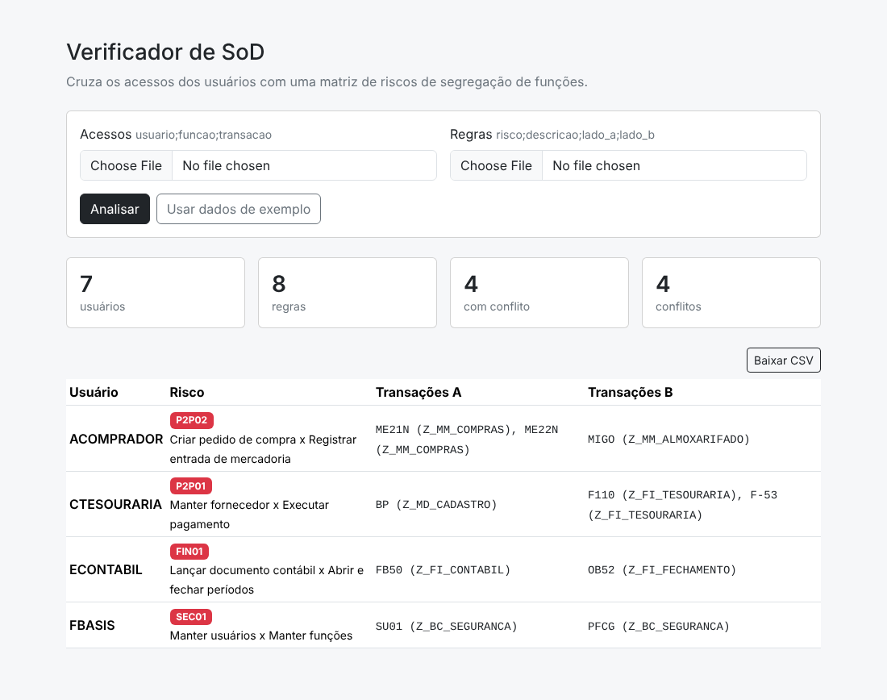

# Verificador de SoD

Cruza os acessos dos usuários com uma matriz de riscos de **segregação de funções (SoD)** e mostra quem acumula transações conflitantes, e por qual função cada acesso foi concedido.

Pensado para revisões de acesso em **SAP S/4HANA**, mas funciona com qualquer sistema que exporte usuário × transação.



## Como funciona

Uma regra tem dois lados. Se o usuário possui pelo menos uma transação de cada lado, há conflito.

```
P2P02;Criar pedido de compra x Registrar entrada de mercadoria;ME21N|ME22N;MIGO
```

O resultado aponta a origem de cada transação, o que ajuda a decidir qual função remover:

```
ACOMPRADOR  P2P02  ME21N (Z_MM_COMPRAS) | MIGO (Z_MM_ALMOXARIFADO)
```

## Arquivos de entrada

**acessos.csv** — exportação de usuários e funções (ex.: SUIM, tabela `AGR_USERS` + `AGR_TCODES`)

```
usuario;funcao;transacao
ACOMPRADOR;Z_MM_COMPRAS;ME21N
ACOMPRADOR;Z_MM_ALMOXARIFADO;MIGO
```

**regras.csv** — matriz de riscos; transações separadas por `|`

```
risco;descricao;lado_a;lado_b
SEC01;Manter usuários x Manter funções;SU01|SU10;PFCG
```

Aceita `;` ou `,`, UTF-8 ou Windows-1252. A coluna `funcao` é opcional.

## Uso

**Web**

```bash
php -S localhost:8000 -t public
```

Enviar os dois CSVs ou clicar em **Usar dados de exemplo**.

**Linha de comando**

```bash
php bin/analisar.php exemplos/acessos.csv exemplos/regras.csv conflitos.csv
```

## Dados de exemplo

[`exemplos/regras.csv`](exemplos/regras.csv) traz oito riscos clássicos de compras, vendas, finanças e segurança. É material didático: uma matriz de produção precisa considerar objetos de autorização e valores de campo, não só transações.

Os usuários e funções em [`exemplos/acessos.csv`](exemplos/acessos.csv) são fictícios.

## Testes

```bash
php tests/run.php
```

Rodam no GitHub Actions a cada push.

## Stack

PHP 8.1+ · Bootstrap 5 · GitHub Actions
